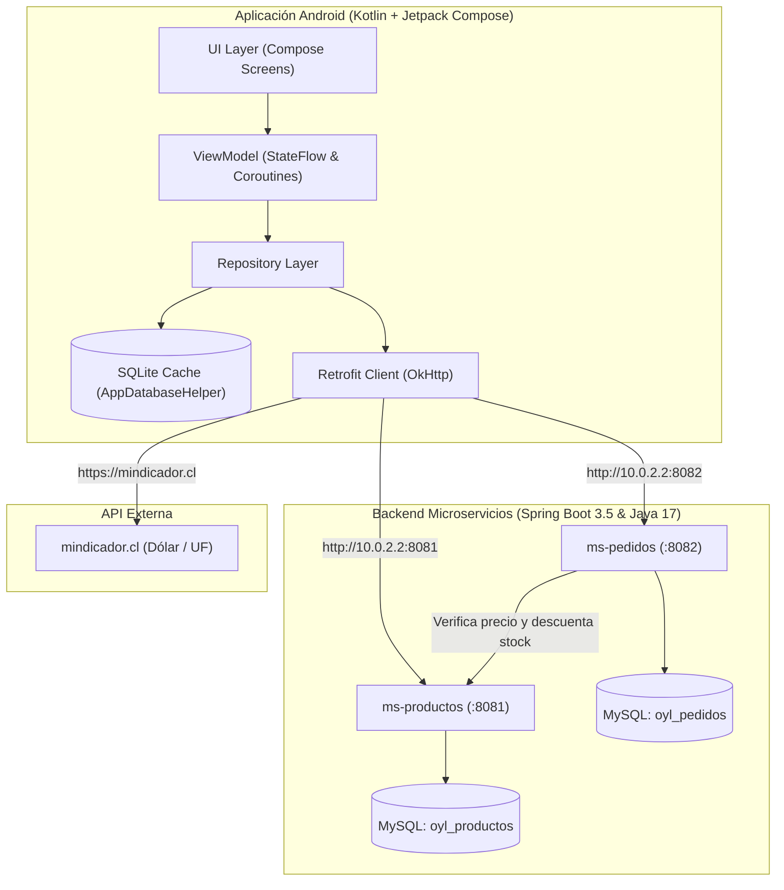
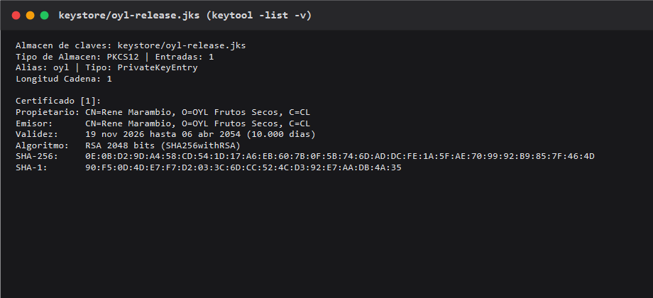
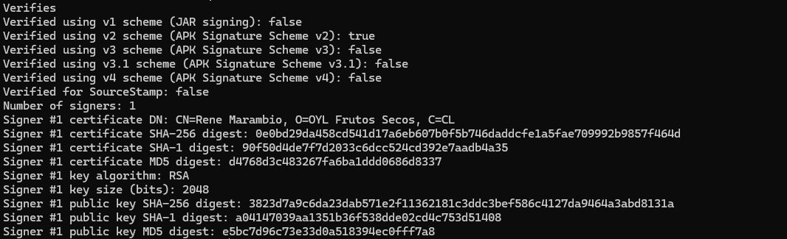
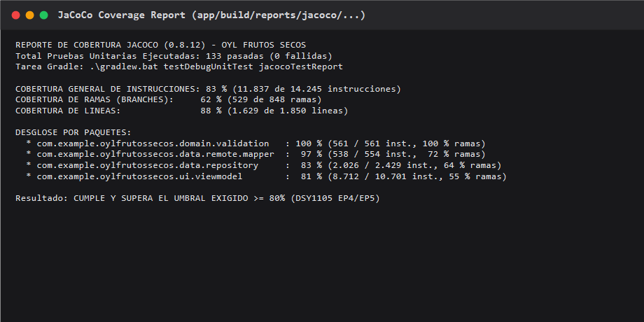
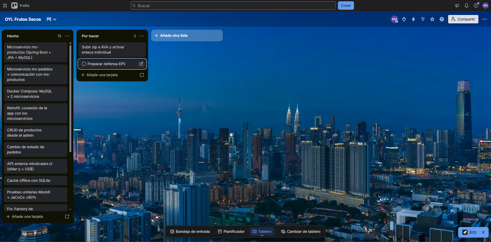

# OYL Frutos Secos 🌰

Aplicación móvil Android nativa en **Kotlin + Jetpack Compose + Clean Architecture (MVVM)** para la gestión de catálogo, inventario, pedidos y ventas de la tienda "OYL Frutos Secos".

Conectada a **microservicios propios en Spring Boot (Spring Web + Spring Data JPA + MySQL)** y consumiendo una **API externa (mindicador.cl)** mediante **Retrofit 2**. Incluye soporte offline con caché local en **SQLite**, suite de pruebas unitarias con **MockK** (> 80 % de cobertura JaCoCo) y empaquetado de APK firmado para Release.

---

## 1. Integrantes e Información del Proyecto

- **Estudiante:** Rene Marambio
- **Modalidad:** Trabajo individual
- **Asignatura:** Desarrollo de Aplicaciones Móviles (DSY1105)
- **Sección:** 004D
- **Evaluación:** EP4 / EP5
- **Repositorio:** [OYL-Frutos-Secos](https://github.com/renemarambio/OYL-Frutos-Secos)

---

## 2. Diagrama de Arquitectura



---

## 3. Estructura de Paquetes

### Aplicación Android (`app/src/main/java/com/example/oylfrutossecos`)
```
├── data/
│   ├── local/                      # SQLite (AppDatabaseHelper), almacenamiento interno de fotos
│   ├── model/                      # Modelos de dominio (Product, Sale, SaleItem, CartItem, User, etc.)
│   ├── remote/                     # Capa de red Retrofit
│   │   ├── api/                    # ProductApiService, OrderApiService, IndicatorApiService
│   │   ├── dto/                    # ProductDto, OrderDto, IndicatorDto, etc.
│   │   ├── mapper/                 # Mapeadores DTO <-> Modelos de dominio y estados en español
│   │   └── RetrofitClient.kt       # Configuración OkHttp (timeouts, logging) y Retrofit por Base URL
│   └── repository/                 # ProductRepository, SalesRepository, IndicatorRepository, CartRepository
├── di/
│   └── ServiceLocator.kt           # Inyección de dependencias para Repositorios y Data Sources
├── domain/
│   └── validation/                 # Validadores centrales de formularios (RUT, email, password, etc.)
├── ui/
│   ├── components/                 # Componentes reutilizables (DolarCard, ProductCard, CartButton, etc.)
│   ├── navigation/                 # Screen (rutas) y NavGraph (NavHost y transiciones)
│   ├── screens/                    # Pantallas Compose (Home, Catalog, Detail, Cart, Checkout, etc.)
│   ├── theme/                      # Tema Material 3, colores y tipografía
│   └── viewmodel/                  # AuthViewModel, ProductViewModel, CartViewModel, SalesViewModel, etc.
└── MainActivity.kt                 # Punto de entrada de la aplicación Android
```

### Backend Microservicios (`backend/`)
```
backend/
├── docker-compose.yml              # Orquestación de MySQL 8 (:3307), ms-productos y ms-pedidos
├── ms-productos/                   # Microservicio de catálogo e inventario (:8081)
│   ├── mvnw, mvnw.cmd, .mvn/       # Maven Wrapper
│   └── src/main/java/.../          # Controllers, Services, Repositories, DTOs y Seeds
└── ms-pedidos/                     # Microservicio de ventas y órdenes (:8082)
    ├── mvnw, mvnw.cmd, .mvn/       # Maven Wrapper
    └── src/main/java/.../          # Controllers, Services, Repositories, DTOs y Cliente HTTP
```

---

## 4. Funcionalidades de la Aplicación

### Perfil Cliente
- **Catálogo de productos con fotos reales:** Visualización en cuadrícula con imágenes reales de alta calidad (licencia libre) servidas desde `ms-productos` y cargadas asíncronamente con Coil, precios en CLP (formateados ignorando puntos de miles) y cálculo estimado en dólares (US$).
- **Filtro y búsqueda:** Filtrado interactivo por categorías (Frutos secos, Semillas, Frutas deshidratadas, Harinas) y barra de búsqueda en tiempo real.
- **Detalle de producto:** Imagen en alta resolución, información nutricional, presentación, stock disponible y valor referencial en US$ mediante la API externa de mindicador.cl.
- **Carrito de compras:** Miniaturas de imágenes de cada producto, control dinámico de cantidades, validación de stock disponible, cálculo de subtotal, IVA (19 %) y costo de despacho según distancia calculada.
- **Proceso de Checkout:** Formulario validado con datos de contacto, dirección y medio de pago. Envío del pedido a `ms-pedidos` con descuento automático de stock en `ms-productos`.
- **Mis Pedidos:** Listado de órdenes realizadas por el cliente autenticado, con detalle de productos comprados y estado de entrega legible ("Pendiente", "En preparación", "En camino", "Entregado", "Cancelado").
- **Centro de Notificaciones y Alertas del Sistema:**
  - Campana superior con distintivo (badge) numérico en tiempo real de notificaciones no leídas.
  - Pantalla dedicada de notificaciones para leer, marcar como leídas y eliminar mensajes.
  - Notificaciones nativas de Android (`NotificationCompat` en canal con permiso Android 13+) al confirmar una compra (*"Pedido ORD-XXXX recibido"*).
  - Detección automática de cambio de estado de despacho al abrir/refrescar *"Mis Pedidos"* (*"Tu pedido ORD-XXXX está EN_CAMINO"*), abriendo la pantalla de pedidos al tocar la notificación.
- **Caché Offline:** En caso de corte de conexión o servidor no disponible, el catálogo se carga automáticamente desde SQLite con el aviso *"Sin conexión con el servidor — mostrando datos guardados"*, impidiendo compras o mutaciones mientras esté sin red.
- **Soporte y contacto:** Llamada telefónica y redacción de correo mediante `Intent` nativo de Android.

### Perfil Administrador
- **Gestión de Inventario (CRUD Completo):**
  - **Crear Producto:** Nombre, descripción, categoría, precio entero CLP, stock inicial, código de barras e imagen (cámara local o URL).
  - **Editar Producto:** Modificación de datos con sanitización de precio (acepta "12.000" y lo normaliza a 12000), previsualización de imagen y ajuste rápido de inventario.
  - **Eliminar Producto:** Eliminación física con confirmación.
  - **Ajuste de Stock (PATCH):** Actualización inmediata de existencias.
  - *Bloqueo de seguridad:* Las opciones de creación, edición y eliminación se deshabilitan cuando la app opera en modo caché sin red.
- **Alertas de Stock Crítico:** Notificación de Android y registro automático en bandeja al ingresar al panel si hay productos con stock ≤ 5 unidades (*"X productos con stock crítico"*), navegando directo a la pantalla de inventario al tocarla.
- **Confirmación de Despacho:** Notificación nativa y registro al actualizar el estado de entrega de un pedido.
- **Escáner de Código de Barras (ZXing):** Búsqueda instantánea de productos en `ms-productos` mediante lectura con la cámara o ingreso manual.
- **Generación de Códigos QR:** Emisión de etiquetas QR imprimibles por producto.
- **Historial Global de Ventas:** Visualización de todas las órdenes registradas en el backend con montos, fechas, clientes y productos.
- **Gestión de Estados de Despacho:** Modificación del estado del pedido (`PATCH /api/orders/{id}/status`) entre los ciclos de vida de despacho.
- **Eliminación de Pedidos:** Anulación y eliminación de registros de venta.

---

### Módulos Especiales

#### 1. Sistema de Fotos Reales de Productos (Coil + ms-productos)
- **14 Fotografías Reales:** Cada producto del seed (`seed-products.json`) cuenta con una imagen real optimizada (~600px, < 150 KB, formato JPG) verificada visualmente y licenciada bajo Creative Commons / Dominio Público desde Wikimedia Commons (ver registro completo en [docs/creditos_imagenes.md](docs/creditos_imagenes.md)).
- **Alojamiento Estático en Backend:** Las fotos se almacenan y sirven directamente como recursos estáticos en `backend/ms-productos/src/main/resources/static/images/` accesibles en `http://localhost:8081/images/<archivo>.jpg`.
- **Carga Dinámica en Android con Coil:** Utiliza `AsyncImage` resolviendo URLs relativas con `BuildConfig.PRODUCTS_BASE_URL` (`http://10.0.2.2:8081/` en emulador), rutas locales de cámara (`content://` o rutas absolutas) y fallback con íconos vectoriales en caso de error de red.

#### 2. Sistema de Notificaciones Persistentes y Android System Notifications
- **Persistencia SQLite:** Almacenamiento local mediante `TABLE_NOTIFICATIONS` en `AppDatabaseHelper` con migración de esquema SQLite versionada, garantizando que el historial de notificaciones no se pierda al cerrar la app.
- **Arquitectura Limpia:** Separación en `NotificationLocalDataSource`, `NotificationRepository` y `NotificationViewModel`, testeables al 100% con MockK sin depender de APIs de Android.
- **Notificaciones del Sistema Android:** Despacho con `NotificationCompat.Builder`, canal dedicado (`oyl_frutos_secos_channel`), soporte y solicitud en tiempo de ejecución del permiso `POST_NOTIFICATIONS` en Android 13+ (API 33+).
- **Deep Linking / Intent Navigation:** Las notificaciones incluyen `PendingIntent` que redirige directamente a la pantalla correspondiente (`MY_ORDERS` o `INVENTORY`) al ser pulsadas.

---

## 5. Endpoints Utilizados

### 1. `ms-productos` (`http://10.0.2.2:8081/` en emulador, `http://localhost:8081/` en PC)

| Método | Endpoint | Descripción | Pantalla / Módulo |
|---|---|---|---|
| `GET` | `/api/products` | Catálogo completo (soporta query `?category=` y `?q=`) | `ProductCatalogScreen`, `HomeScreen`, `CategoryListScreen` |
| `GET` | `/api/products/{id}` | Detalle completo de un producto por ID | `ProductDetailScreen`, `AddEditProductScreen` |
| `GET` | `/api/products/barcode/{code}` | Búsqueda por código de barras escaneado | `QrScannerScreen` |
| `GET` | `/api/products/categories` | Listado de categorías con cantidad de productos | `CategoryListScreen`, `HomeScreen` |
| `POST` | `/api/products` | Crea un nuevo producto (valida restricciones) | `AddEditProductScreen` (Modo Crear) |
| `PUT` | `/api/products/{id}` | Actualiza datos generales de un producto existente | `AddEditProductScreen` (Modo Editar) |
| `DELETE` | `/api/products/{id}` | Elimina el producto del sistema | `ProductDetailScreen`, `ProductCatalogScreen` |
| `PATCH` | `/api/products/{id}/stock` | Ajusta el stock del producto (`{ "stock": N }`) | `ProductDetailScreen`, `AddEditProductScreen` |
| `POST` | `/api/products/{id}/decrease-stock` | Endpoint interno consumido por `ms-pedidos` para descontar stock | Comunicación inter-servicios |

### 2. `ms-pedidos` (`http://10.0.2.2:8082/` en emulador, `http://localhost:8082/` en PC)

| Método | Endpoint | Descripción | Pantalla / Módulo |
|---|---|---|---|
| `GET` | `/api/orders` | Obtiene el historial completo de ventas (Admin) | `SalesHistoryScreen` |
| `GET` | `/api/orders?customerEmail={email}` | Lista los pedidos del cliente autenticado | `MyOrdersScreen` |
| `GET` | `/api/orders/{id}` | Detalle de una orden específica | Detalle en `SalesHistoryScreen` y `MyOrdersScreen` |
| `POST` | `/api/orders` | Genera una nueva compra, valida existencias y descuenta stock | `CheckoutScreen` |
| `PATCH` | `/api/orders/{id}/status` | Actualiza estado del pedido (`PENDIENTE`, `PREPARANDO`, etc.) | `SalesHistoryScreen` (Acción Admin) |
| `DELETE` | `/api/orders/{id}` | Elimina una orden del registro | `SalesHistoryScreen` (Acción Admin) |

### 3. API Externa mindicador.cl (`https://mindicador.cl/`)

| Método | Endpoint | Descripción | Pantalla / Módulo |
|---|---|---|---|
| `GET` | `/api/dolar` | Obtiene el valor observado del dólar estadounidense y fecha | `HomeScreen`, `ProductCatalogScreen`, `ProductDetailScreen` |
| `GET` | `/api/uf` | Obtiene el valor observado de la Unidad de Fomento (UF) | `IndicatorRepository` (disponible) |

---

## 6. Guía de Ejecución

### Requisitos Previos
- **Java JDK 17** instalado y configurado en `JAVA_HOME`.
- **Android Studio** Ladybug (2024.2+) con Android SDK 35/36 y emulador con Google Play Services (API 24+).
- **Docker** y **Docker Compose** (opción recomendada para backend) o **XAMPP / MySQL local**.

---

### Paso 1: Levantar los Microservicios (Backend)

#### Opción A: Docker Compose (Recomendada)
Desde la raíz del repositorio:
```bash
cd backend
docker compose up --build
```
> **Nota:** MySQL se expone en el puerto **3307** (`root` / `oyl1234`) para evitar conflictos con instalaciones locales de XAMPP. Los microservicios quedan listos en:
> - `ms-productos`: `http://localhost:8081` (Swagger: `http://localhost:8081/swagger-ui.html`)
> - `ms-pedidos`: `http://localhost:8082` (Swagger: `http://localhost:8082/swagger-ui.html`)

#### Recargar Seed y Fotos (Limpieza de Base de Datos)
Si la base de datos ya tenía registros previos sin imágenes y se requiere recargar el seed completo con las rutas de las fotos reales:
```bash
cd backend
docker compose down -v
docker compose up --build -d
```
El parámetro `-v` elimina el volumen persistente de MySQL (`backend_oyl-mysql-data`), forzando a que `ms-productos` vuelva a poblar las tablas con `seed-products.json` y sus URLs relativas `/images/<archivo>.jpg`.

#### Opción B: Ejecución Manual con Maven Wrapper
Si se utiliza MySQL local (XAMPP en puerto 3306):
```bash
# Terminal 1 - Productos
cd backend/ms-productos
./mvnw spring-boot:run     # En Windows: .\mvnw.cmd spring-boot:run

# Terminal 2 - Pedidos
cd backend/ms-pedidos
./mvnw spring-boot:run     # En Windows: .\mvnw.cmd spring-boot:run
```

---

### Paso 2: Ejecutar las Pruebas Unitarias

#### Pruebas del Backend (Spring Boot + Mockito + MockMvc)
```bash
cd backend/ms-productos && ./mvnw test
cd ../ms-pedidos && ./mvnw test
```

#### Pruebas de la Aplicación Android (JUnit 4 + MockK + Coroutines Test)
```bash
# Windows
.\gradlew.bat testDebugUnitTest

# Linux / macOS
./gradlew testDebugUnitTest
```

#### Generar Reporte de Cobertura JaCoCo (>= 80 %)
```bash
# Windows
.\gradlew.bat testDebugUnitTest jacocoTestReport

# Linux / macOS
./gradlew testDebugUnitTest jacocoTestReport
```
El reporte HTML generado se ubica en: `app/build/reports/jacoco/jacocoTestReport/html/index.html`.

---

### Paso 3: Ejecutar la Aplicación en el Emulador

1. Abrir el proyecto `OYL-repo` en Android Studio.
2. Iniciar un emulador Android (API 24 o superior).
3. Presionar ▶ **Run 'app'** (`Shift + F10`).
4. Para autenticarse:
   - Ingresar cualquier correo y clave válida (ej. `cliente@oyl.cl` / `123456`), o
   - Usar el botón **"Entrar como invitado"** / seleccionar rol Admin en ajustes.

---

### Paso 4: Generar y Verificar el APK Firmado (Release)

Para compilar el APK de producción firmado con el keystore release:

```bash
# Windows
.\gradlew.bat assembleRelease

# Linux / macOS
./gradlew assembleRelease
```

El APK resultante se genera en `app/build/outputs/apk/release/app-release.apk` y se copia en:
`release/OYL-Frutos-Secos-v1.0.apk`.

Para verificar la firma con `apksigner`:
```bash
apksigner verify --print-certs -v release/OYL-Frutos-Secos-v1.0.apk
```

---

## 7. Evidencias y Capturas

### 1. Keystore Release (`keystore/oyl-release.jks`)
Certificado digital generado con `keytool`, validez de 10.000 días (hasta 2054) a nombre de René Marambio para OYL Frutos Secos:



---

### 2. APK Firmado y Verificación (`release/OYL-Frutos-Secos-v1.0.apk`)
Verificación criptográfica realizada con `apksigner` confirmando esquema de firma APK Signature Scheme v2 activo y válido:



---

### 3. Reporte de Cobertura JaCoCo (82.74 % en Lógica de Negocio)
Superación del 80 % exigido en las capas de ViewModels, Repositorios, Validaciones y Mapeadores:



Para un desglose detallado de las **184 pruebas unitarias** (100 % de aprobación y 82.74 % de cobertura de instrucciones), consultar el documento [docs/cobertura.md](docs/cobertura.md).

## Planificacion (Trello)

Tablero: https://trello.com/b/6affe479cd4edf081789eb6e/oyl-frutos-secos


